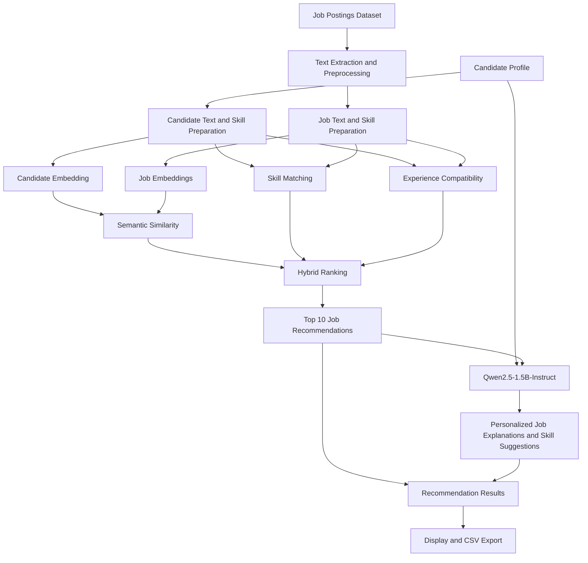

# Intelligent Job Recommendation System

An AI-powered job recommendation system that matches a candidate's profile with relevant job postings using semantic similarity, skill matching, experience compatibility, and hybrid ranking. It also uses an open-source Large Language Model (LLM) to generate personalized explanations for recommended jobs and suggest areas for skill development.

DEPLOYED LINK : https://eclectic-brigadeiros-6ece13.netlify.app/

## Project Overview

Finding suitable job opportunities can be difficult when job descriptions and candidate profiles contain different wording for similar skills and responsibilities. Keyword-only search may miss relevant opportunities because it does not always understand the meaning of the text.

This project addresses that problem by combining Natural Language Processing (NLP), sentence embeddings, and a hybrid recommendation approach. The candidate provides details such as education, skills, experience, preferred roles, and location. The system compares this profile with job postings, ranks the most relevant opportunities, and displays the top 10 recommendations.

An open-source LLM, **Qwen2.5-1.5B-Instruct**, is used after ranking to explain why a job may match the candidate, identify skills listed as missing by the matching component, and suggest learning areas. The LLM is loaded locally in the Google Colab runtime through Hugging Face Transformers; the project does not require a paid OpenAI or Gemini inference API key.

## Objectives

- Extract and preprocess useful information from job-posting text and candidate profiles.
- Represent candidate and job-description text so that semantic similarity can be calculated.
- Identify and compare candidate skills with skills mentioned in job postings.
- Consider experience compatibility when ranking job opportunities.
- Combine semantic similarity, skill matching, and experience compatibility into a hybrid score.
- Recommend and display the top 10 jobs for a candidate.
- Use a generative LLM to provide explanations and skill-development suggestions for recommended jobs.
- Save the candidate profile and recommendation results for later review.

## Technologies Used

| Technology / Library | Purpose |
|---|---|
| Python | Main programming language |
| Google Colab | Notebook-based development and execution environment |
| Pandas | Dataset loading, cleaning, manipulation, and result tables |
| NumPy | Numerical operations and similarity-score calculations |
| Scikit-learn | Text-processing utilities and supporting NLP/ML operations, including TF-IDF where used in the notebook |
| Sentence Transformers | Generate semantic embeddings for candidate and job text |
| `all-MiniLM-L6-v2` | Sentence-embedding model used for semantic matching, as configured in the notebook |
| PyTorch | Deep-learning framework used to run the embedding and generative models |
| Hugging Face Transformers | Load and run the Qwen instruction-tuned language model |
| Qwen2.5-1.5B-Instruct | Open-source LLM used to generate job-fit explanations and learning suggestions |

> The exact library versions should be taken from the working notebook/runtime. The notebook may contain additional packages depending on the NLP analysis cells enabled in the submitted version.

## Methodology

### 1. Job Dataset Loading

The system loads a dataset of job postings. Job records may contain fields such as job title, company, location, job description, required skills, and experience requirements. The dataset is inspected to understand its columns and identify missing or inconsistent values.

### 2. Text Extraction and Preprocessing

Relevant text is selected from the job-posting fields and candidate profile. Text is cleaned and normalized as required by the notebook, and useful fields such as skills, role titles, and experience information are prepared for matching. This helps reduce noise and makes job and candidate information easier to compare.

### 3. Semantic Representation

The Sentence Transformers model converts job text into numerical embeddings. The candidate profile is converted into a corresponding embedding when a recommendation request is made. Similarity between the candidate and job embeddings is used to estimate how closely their meanings and requirements align, even when they use different wording.

### 4. Skill Matching

The candidate's skills are normalized and compared with skills identified in each job posting. The matching component calculates a skill score and records matched and missing skills. These results help explain which candidate skills align with a job and which listed skills may need improvement.

### 5. Experience Compatibility

The candidate's years of experience are compared with the experience requirement associated with each job. The result is converted into an experience-compatibility score that contributes to the final ranking.

### 6. Hybrid Ranking

The system combines the semantic, skill, and experience scores using configurable weights. The default weights in the recommendation function are:

| Component | Default weight |
|---|---:|
| Semantic similarity | 0.70 |
| Skill match | 0.25 |
| Experience compatibility | 0.05 |

The hybrid score is calculated as:

```text
Hybrid Score = (0.70 × Semantic Score)
            + (0.25 × Skill Score)
            + (0.05 × Experience Score)
```

Jobs are sorted by their hybrid score, with semantic and skill scores used as additional sorting criteria. The system returns the highest-ranked jobs, normally the top 10.

### 7. LLM-Based Explanation (CO4)

After the jobs have been ranked, the system passes the candidate profile and each recommended job's available details to **Qwen2.5-1.5B-Instruct**. The LLM generates a natural-language explanation covering:

- Why the job may be suitable for the candidate.
- Which candidate skills match the job.
- Which skills are identified as missing by the matching component.
- Practical learning suggestions to improve suitability.

The LLM supports explanation generation; it does not calculate or replace the recommendation ranking. It uses the information supplied by the notebook and does not independently verify vacancies or hiring decisions.

### 8. Results and Export

The notebook displays the candidate profile, the top 10 recommended jobs, their scores, matched and missing skills, and generated LLM explanations. It can save the candidate profile and final recommendation table as CSV files.

## System Architecture



## Candidate Profile Configuration

The candidate profile is defined in a Python dictionary in the recommendation cell. The fields include:

- `name` and `email`: candidate identification details.
- `education`, `branch`, `college`, and `graduation_year`: academic background.
- `skills`: list of technical skills.
- `experience_years`: candidate's experience in years; use `0` for a fresher.
- `preferred_roles`: list of job roles of interest.
- `preferred_location`: preferred job location.
- `summary`: brief professional or academic summary.

Replace the sample values with the candidate's correct information before running the recommendation process. Avoid committing personal contact details to a public repository.

## Output Files

The notebook is configured to generate the following files:

| File | Description |
|---|---|
| `candidate_profile.csv` | Candidate profile displayed by the notebook |
| `final_top_10_jobs_with_llm_explanations.csv` | Top 10 recommendations with scores, matched/missing skills, and LLM-generated explanations |

The exact output names may differ if they have been changed in the notebook.

## Important Notes and Limitations

- The quality of recommendations depends on the completeness, accuracy, and freshness of the job-postings dataset.
- A hybrid match score is a ranking score, not a probability of getting an interview or an offer.
- The system can only compare fields that are present and correctly processed in the dataset.
- LLM explanations are generated from the profile and job information supplied to the model. They may contain errors, so users should verify important details against the original job posting.
- The system does not independently confirm whether a vacancy is still open, apply for jobs, or guarantee employment outcomes.
- The first LLM run downloads model weights. An internet connection is generally needed for the initial download; subsequent runs may use the locally cached model files.
- Running the LLM locally in Colab does not require a paid OpenAI or Gemini inference API key. Hardware availability and model-loading requirements still apply.

## Future Scope

- Add resume/PDF parsing to automatically populate candidate profiles.
- Improve skill extraction using named-entity recognition and domain-specific vocabularies.
- Add topic discovery and multilingual job-description processing where supported by the dataset.
- Evaluate recommendations using a larger set of human-reviewed relevance labels.
- Add filters for salary, employment type, remote work, and other job preferences when those fields are available.
- Add retrieval-augmented generation (RAG) using verified career guidance and job-related documents to provide source-grounded explanations.
- Develop a web interface so candidates can create profiles and view recommendations interactively.

## License and Data

Qwen2.5-1.5B-Instruct is distributed under its own model license. Review the model card and license terms before redistributing or deploying the model. The job dataset may have separate access and usage conditions; follow the dataset provider's terms. Add the project's chosen repository license and dataset attribution here before publishing the repository.

## Acknowledgements

- Sentence Transformers for semantic text embeddings.
- Hugging Face for the Transformers ecosystem and model distribution tools.
- Qwen team for the Qwen2.5 instruction-tuned model.
- The providers of the job-postings dataset used in the project.
